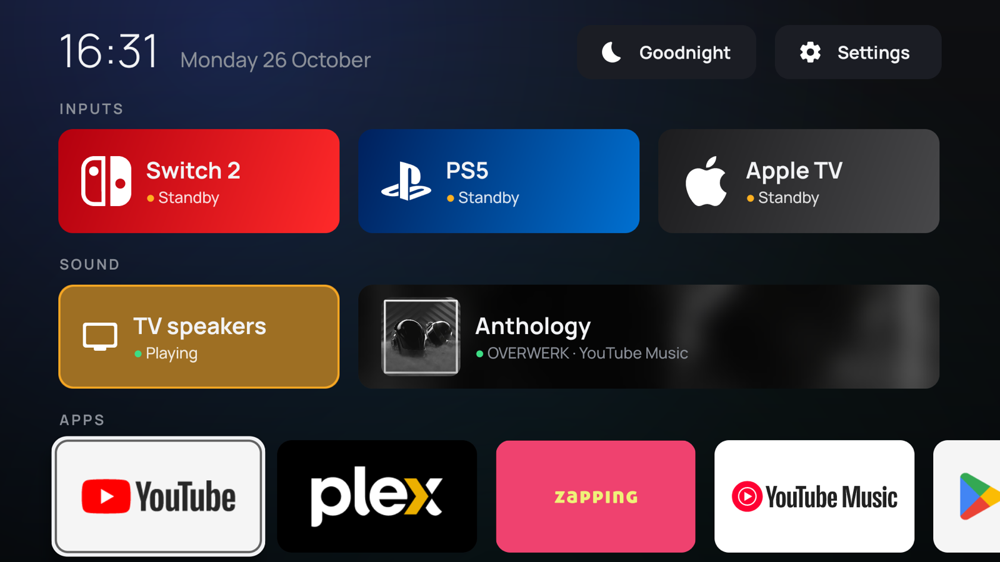
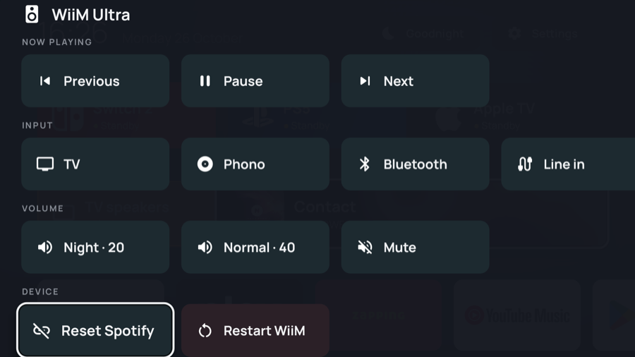
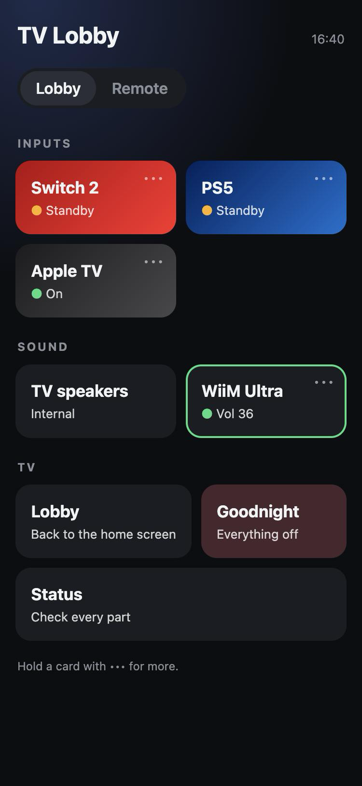
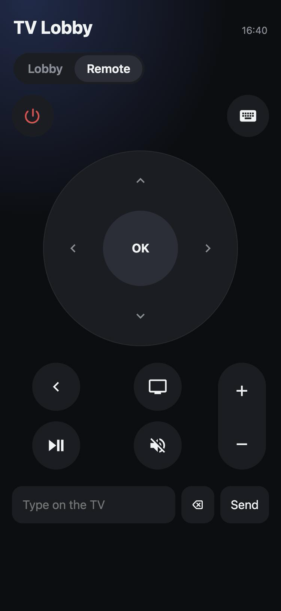

# tv-lobby

A home screen for a TCL Google TV (Android 14) that replaces the Google TV launcher. It puts the HDMI devices, the sound output and the apps one or two clicks from Home, and adds a phone remote.



<p>
  
</p>
<p>
  
  
</p>

## On the TV

- **Inputs:** Switch 2 (HDMI 2), PS5 (HDMI 3) and Apple TV (HDMI 4). Each tile shows whether its device is on, in standby or off, from HDMI-CEC when the device is on CEC, else from the HDMI signal. Opening a tile switches the input and wakes the device over CEC. Hold OK (or press Menu) for **Open** and **Turn off**.
- **Sound:** TV speakers or the WiiM Ultra on HDMI eARC. The active output is highlighted and follows changes made from the TCL menu.
- **WiiM:** its tile shows the volume, or the song, artist and service over the album art while the WiiM plays its own source (a cast, Spotify, Bluetooth…). The lobby's background takes the cover's colour. Meanwhile the TV remote's volume and mute keys set the WiiM's volume directly, on any screen, with a small indicator; on TV sound they work over CEC as usual. If the TV sends its sound to the WiiM while the WiiM is elsewhere, the tile turns amber. Hold OK on it for the WiiM's menu: playback, its inputs (TV and Phono first), two volume presets, mute, **Reset Spotify** (for when Spotify stops listing the WiiM) and **Restart WiiM** (for when its screen or knob stop responding).
- **Apps:** pinned apps first, then every other TV app. Hold OK on an app to pin it, move it to the front or hide it. Hidden apps wait in a "Hidden apps" tile at the end of the row. The choices are saved on the TV.
- **Goodnight:** after a confirmation, puts every CEC device to sleep (consoles, Apple TV, WiiM), then the TV.
- **Settings:** opens the TV settings. Hold OK on it for **Lobby status**, which checks each part (Home, the sound permission, the TV's ADB, the volume keys, HDMI-CEC, the WiiM, Spotify Connect, the phone remote) and says what to do when one fails.
- Home focuses the tile you last opened.

## On the phone

Open `http://<TV address>:8888` on a phone on the same network. It works while the TV shows an HDMI input.

- **Lobby tab:** inputs, sound, Lobby, Goodnight and Status. Hold a card marked ••• for the TV's menus (Open / Turn off, the WiiM menu).
- **Remote tab:** power, a click-pad, back, home, play/pause, mute, volume (hold to repeat) and a keyboard that types into the TV's focused text field. The keys go through the TV, so they reach an HDMI device over CEC like the TV's own remote. `#remote` opens the page on this tab.
- **Add to Home Screen** gives it an icon and a full-screen window on iPhone.

## Setup

Requirements: JDK 17+, the Android SDK (`brew install --cask android-commandlinetools`, platform 35), and network debugging on the TV.

1. Copy `lobby.properties.example` to `lobby.properties` (gitignored) and fill in the TV's and the WiiM's addresses. Give both a fixed address in the router.
2. Create the signing key (see [Signing](#signing)).
3. Run `./deploy.sh`. The first time, the TV asks to allow debugging for TV Lobby's key: choose **Always allow**.

```bash
./deploy.sh          # build, install, set up, make it Home
./deploy.sh stock    # uninstall TV Lobby, give Home back to Google TV
TV=192.168.1.20:5555 ./deploy.sh   # another TV address for one run
```

Besides installing, `deploy.sh`:

- grants `WRITE_SECURE_SETTINGS` (the sound switch and the volume keys need it);
- disables `launcherx` and `setupwraith` for user 0, whose HOME filters carry system priorities that always beat a third-party launcher;
- enables the volume-keys accessibility service;
- restarts the phone remote right after the update, and keeps the TV on whatever it was showing.

If a firmware update re-enables the stock launchers, revokes the permission or turns off the volume keys, the lobby repairs them when it starts. `stock` uninstalls the app for that reason: only re-enabling the launchers wouldn't last.

### Signing

Release builds are signed with a key kept outside the repo, in `~/.config/tv-lobby/` (`release.keystore` and `signing.properties` with its path, alias and password; `TV_LOBBY_SIGNING` points elsewhere). Back both files up, for example in a password manager. Android only installs an update signed with the same key; otherwise the app has to be uninstalled first, which erases the pinned and hidden apps and the TV's approval of the app's ADB key.

## Customizing

Edit [`Lobby.kt`](app/src/main/java/com/leo/tvlobby/Lobby.kt):

- `inputs`: label, HDMI port, `TvInputService` id, brand mark, gradient colours and an optional wake hint. `adb shell dumpsys tv_input` lists the ids; `HW15`–`HW18` are HDMI 1–4.
- `outputs`: TCL's sound-output codes for the Global setting `tcl_device_out_type` (2 is the speakers, 16 is ARC/eARC); the WiiM's address comes from `lobby.properties`.
- `wiimVolumePresets`: the WiiM menu's volume presets.
- `favoriteApps` / `hiddenApps`: package names, used until you pin or hide an app from the lobby.

## How it works

- **HDMI:** `ACTION_VIEW` on `TvContract.buildChannelUriForPassthroughInput(id)`, which TCL's `com.tcl.tv` opens.
- **Sound:** TCL's settings switch the output by writing `tcl_device_out_type`, and TCL's audio service reroutes when it changes. The app writes the same setting.
- **TV's ADB:** waking, turning off, the phone remote's keys and screen changes need system permissions, so the app runs them through the TV's own network ADB (`127.0.0.1:5555`, via [dadb](https://github.com/mobile-dev-inc/dadb)), on a connection kept open between commands.
- **Wake:** `cmd hdmi_control deviceselect` for the CEC device on the tile's port (found in `dumpsys hdmi_control`), which powers it on and makes it the active source.
- **Turn off:** CEC `<Standby>` through `IHdmiControlService.sendStandby`. TCL wraps `hdmi_control` in its own binder interface, so `service call` stamps the wrong token; the app instead runs its own `CecTool` class as the shell user with `app_process`, and reads the transaction number from the framework at each call.
- **WiiM:** LinkPlay's HTTP API (`getPlayerStatus`, `getMetaInfo`, `setPlayerCmd:…`; `plm_support` in `getStatusEx` lists the inputs; `StartRebootTime:1` restarts it, since the documented `reboot` is unknown to its firmware). The WiiM serves LinkPlay's self-signed certificate, so the app pins that exact certificate and talks only to the configured address.
- **Spotify Connect:** the WiiM's ZeroConf endpoint on port 5356 (`getInfo` for the status, `resetUsers` for the reset). It is plain HTTP, so the build generates a network security rule that allows plain HTTP for the WiiM's address only.
- **Volume keys:** `VolumeKeyService`, an accessibility service that only filters key events (no window content). It polls the WiiM every 4 s and takes the volume keys while the WiiM isn't on TV sound.
- **Phone remote:** `RemoteService`, a foreground service with a minimal HTTP server for the page in `assets/web` and a small JSON API. Keys go through `input keyevent` / `input text`, limited to a fixed list.

## Known limits

- **Switch 2:** it isn't on HDMI-CEC, so the TV can't wake or turn it off. Opening its tile shows how to wake it (HOME on a controller).
- **Phone remote in standby:** Android's Low Power Standby blocks network access for apps outside a list only Google and TCL apps can edit, so the page doesn't answer while the TV sleeps.
- **Boot:** TCL's app-boot manager drops the boot broadcast for apps outside its own allowlist. The phone remote and the repairs start when the lobby opens as Home.
- **Android install:** Chrome only installs pages served over HTTPS, so on Android the page opens with the browser bar.
- **No login:** anyone on the home network can use the phone remote.
- **`input text`** types ASCII only.

## Credits

Brand marks (`res/drawable/mark_*.xml`): [Simple Icons](https://simpleicons.org), CC0; the trademarks belong to their owners. Icons (`res/drawable/icon_*.xml`): [Material Symbols](https://github.com/google/material-design-icons), Apache 2.0. Font: [Manrope](https://github.com/googlefonts/manrope), SIL Open Font License (`assets/fonts/OFL.txt`).
