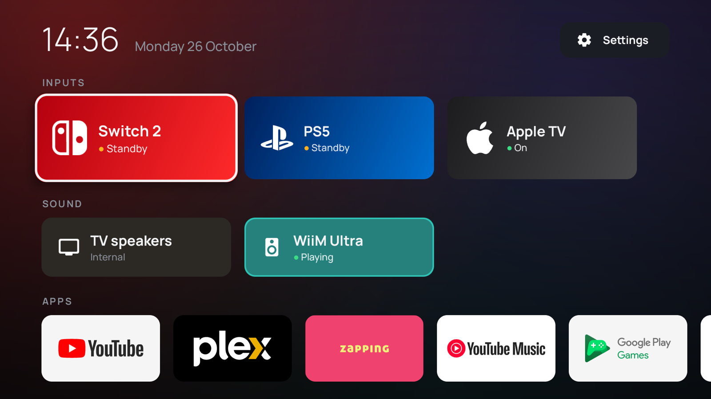

# tv-lobby

A home screen for the living-room TCL Google TV (Android 14). It replaces the Google TV launcher. Everything you use is one or two clicks from Home:

- **Inputs:** Switch 2 (HDMI 2), PS5 (HDMI 3), Apple TV (HDMI 4). Each tile shows whether the device is on, in standby or off, and wakes the device over HDMI-CEC when you open it.
- **Sound:** TV speakers or WiiM Ultra (HDMI eARC). The active output is highlighted. It stays correct when you change the output from the TCL menu.
- **Apps:** favorites first, then every other installed TV app.
- **Settings:** a button next to the clock opens the TV settings.



## Deploy

ADB over the network must be on (the TV is at `192.168.1.20:5555`; set `TV=` to change it).

```bash
./deploy.sh          # build, install, grant permission, make it Home
./deploy.sh stock    # give Home back to Google TV
```

The script does more than install the APK:

- It grants `WRITE_SECURE_SETTINGS`, which the audio switch needs.
- It disables `launcherx` and `setupwraith` for user 0. Their HOME filters have system priorities that always win against a third-party launcher. `stock` turns them back on.

## Customizing

Edit [`Lobby.kt`](app/src/main/java/com/leo/tvlobby/Lobby.kt):

- `inputs`: tile label, `TvInputService` id, brand mark and gradient colors. To list the ids, run `adb shell dumpsys tv_input`. `HW15`–`HW18` are HDMI 1–4.
- `outputs`: TCL's sound-output codes, which are written to the Global setting `tcl_device_out_type`. 2 is the speakers, 16 is ARC/eARC.
- `favoriteApps` / `hiddenApps`: package names.

The brand marks in `res/drawable/mark_*.xml` come from [Simple Icons](https://simpleicons.org) (CC0). The trademarks belong to their owners.

The `res/drawable/icon_*.xml` icons are [Material Symbols](https://github.com/google/material-design-icons) (Apache 2.0).

The [Manrope](https://github.com/googlefonts/manrope) font in `assets/fonts` is under the SIL Open Font License (`OFL.txt` next to it).

## How it works

- **HDMI:** `ACTION_VIEW` on `TvContract.buildChannelUriForPassthroughInput(id)`, which TCL's `com.tcl.tv` opens.
- **Wake:** the input tile also runs `cmd hdmi_control deviceselect` for the device on that port (found by port in `dumpsys hdmi_control`), which sends the CEC power-on and makes it the active source. That needs a system permission, so the app runs it through the TV's own network ADB (`127.0.0.1:5555`, via [dadb](https://github.com/mobile-dev-inc/dadb)). The first time, the TV asks to allow debugging for TV Lobby's key: choose **Always allow**. A device with CEC turned off (Switch 2 here) still switches, it just isn't woken.
- **Audio:** TCL's TvSettings switches the output by writing `tcl_device_out_type`, and the TCL audio service reroutes when that value changes. The app writes the same setting.

Requirements: JDK 17+ and the Android SDK (`brew install --cask android-commandlinetools`, platform 35).
